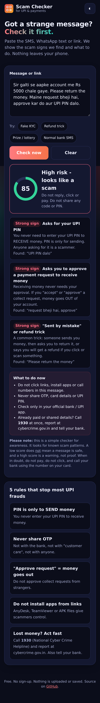
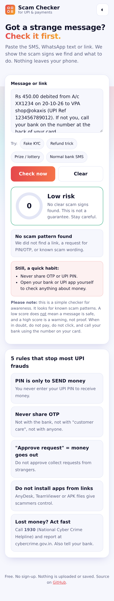
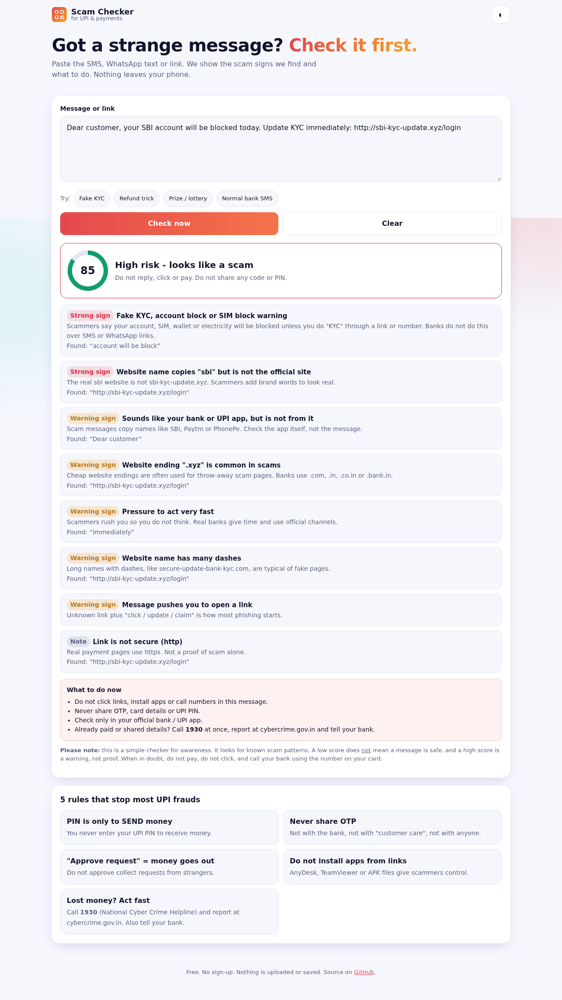

# UPI Scam Checker

Paste an SMS, WhatsApp message or link and see if it looks like a **UPI / payment scam**. You get a risk score, the exact scam signs found, and what to do next.

**Live app:** https://akash991833.github.io/upi-scam-checker/

| High-risk message (mobile) | Safe-looking message (mobile, light) |
|---|---|
|  |  |



## What it checks

- Asking for your **UPI PIN** to "receive" money
- Asking for **OTP, CVV, card number or password**
- Fake **KYC / account block / SIM block / electricity cut** warnings
- **Refund tricks** and "sent by mistake, please return"
- Asking you to **approve a collect request** or scan a QR to receive money
- **Prize, lottery, cashback** you never joined
- **Remote-control apps** (AnyDesk, TeamViewer) and **APK** installs
- Fake **police / CBI / customs / courier** pressure
- Easy-money jobs and investment offers, "processing fee" demands
- Links: short links, number (IP) addresses, "@" tricks, look-alike letters, brand names on unofficial sites, cheap website endings
- Works with English, Hinglish and basic Hindi text

## Privacy

Runs fully in your browser. The message is never sent anywhere or saved.

## Honest limits

This is a **lite, rule-based awareness tool**. It is not AI and does not connect to any bank, UPI or fraud database.

- It finds known scam patterns. A new trick can pass with a low score.
- A low score is not a guarantee of safety. A high score is a warning, not proof.
- It cannot check if a phone number or UPI ID is real.
- On a small built-in test set it flagged 15 of 15 sample scam messages and raised 0 of 10 normal messages (bank debit SMS, OTP SMS, chats). That set is small and was written by the author, so real-world accuracy will be lower.

If you lose money: call **1930** (National Cyber Crime Helpline), report at https://cybercrime.gov.in and inform your bank at once.

## Run it yourself

```bash
python3 -m http.server 8000   # then open http://localhost:8000
node tests/engine-test.js     # run the sample-message checks
```

Plain HTML, CSS and JavaScript. No build step. Hosted free on GitHub Pages.

## License

MIT
